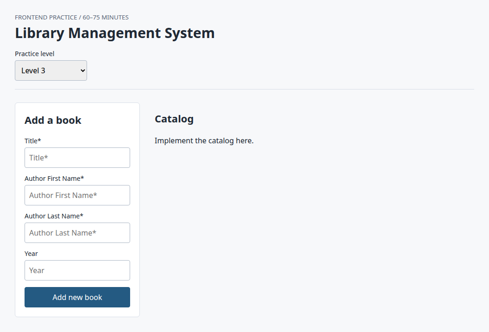

# Library catalog practice

React + Vite starter for a timed library-catalog exercise: a level selector and page shell, joined records in `src/book.json`, an in-memory mock API, unfinished components, and visible Vitest acceptance tests.



The on-page budget is 60–75 minutes. This package is independently reconstructed practice material. It is separate from any official CodeSignal question and includes no private APIs or hidden tests. [Open the starter in StackBlitz](https://stackblitz.com/github/clement55688/react-library-oa-practice?file=README.md) and fork a copy before editing. Layout notes came from the [original StackBlitz starter](https://stackblitz.com/edit/tz2afjmf?file=README.md).

## Features

### Library catalog

`src/App.jsx` renders a “Library Management System” page and a practice-level `<select>` (Level 1, Level 2, Level 3, Practice Level 4). The default level is 3, and tests can pass a numeric `level` prop. Level 1 shows the aside “Start with local data.” Levels 2–4 show the add-book form. The catalog column is a heading, “Catalog”, plus the placeholder “Implement the catalog here.”

`BookCard` is an `<article class="book">` with a placeholder title. `GroupContainer` is a `<section class="group">` whose `aria-label` and `<h3>` are the group label; it does not render books yet. `groupBooks` in `src/catalog.js` returns `[]`.

### book.json

`src/book.json` is the local catalog `App.jsx` imports for the early exercises. It contains 11 books. Each record has `id`, `title`, `authorId`, and an `author` object (`id`, `firstName`, `lastName`). `year` is omitted on “Selected Papers on Computer Languages” and “The Adventures of Huckleberry Finn”.

### Mock APIs

`src/api/libraryApi.js` stands in for a backend. There is no server.

- `getBooks()` waits 25ms, then resolves to a shallow copy of each book in `src/data/mockData.js` (12 books).
- `getAuthor(id)` waits 25ms, then resolves to a copy of that author, or rejects with `ApiError` and `status` 404.
- Both functions resolve to plain data (objects and arrays).

`mockData.js` lists 7 authors and those 12 books. “An Unattributed Journey” uses `authorId: "deleted-author"`, which is absent from the author list. `initialBooks` in the same file joins books to authors and leaves that record out. The page does not call the API yet. Levels 3 and 4 in the tests are the spec for that work.

### Starter code

The interactive pieces are unfinished on purpose. TODO comments in `App.jsx`, `AddBookForm.jsx`, `BookCard.jsx`, `GroupContainer.jsx`, and `catalog.js` mark grouping and sorting, controlled inputs, validation, immutable adds, async loading, author joins, 404 handling, loading and error UI, an unknown-author group, and year sorting.

`AddBookForm` renders labeled inputs named `title`, `authorFirst`, `authorLast`, and `year`, plus `<input type="submit" value="Add new book" />`. Submit runs `preventDefault`. The form does not store input state and does not call `onAdd`.

### Tests

`test/level1.test.jsx` through `test/level4.test.jsx` are the acceptance tests (Vitest, jsdom, React Testing Library). They specify last-name-initial grouping, optional years, the add-book form, loading and joining through the mock API, non-404 errors with retry, a final “Unknown author” group, and year sorting. `test/setup.js` registers jest-dom and unmounts after each test. `PREPARE.md` is the short brief for someone about to attempt the exercise.

## Tech stack

- React 19 and React DOM
- Vite 7 (`dev`, `build`, `preview`)
- Vitest 4, jsdom, React Testing Library, `@testing-library/jest-dom`, and `@testing-library/user-event`
- Plain CSS in `src/index.css`
- Node.js 22.12+ (`engines` in `package.json`)

The source is JavaScript and JSX. Data comes from `book.json` and the mock modules above.

## Run the app

From this folder, with Node.js 22.12 or newer:

```sh
npm install
npm run dev
```

Vite prints a local URL (`http://localhost:5173/` by default). The screen is the one in the screenshot: the level selector, the add-book form at the default level, and the catalog placeholder.

Verified with Node.js 22.23.4: `npm run dev` starts Vite 7.3.6 and serves the starter UI.

## Run the tests

```sh
npm test
```

`npm test` is `vitest run`. Related scripts already in `package.json`:

| Script | What it runs |
| --- | --- |
| `npm run test:watch` | Vitest in watch mode |
| `npm run test:level1` | `test/level1` only (`test:level2`, `test:level3`, and `test:level4` match) |
| `npm run build` | production build |
| `npm run preview` | serve the production build |

Verified with Node.js 22.23.4: `npm test` runs the full suite and exits non-zero because the starter components are still stubs. The result on this tree is **5 passed, 14 failed** (19 tests). The passing Level 3 case calls `getBooks` and `getAuthor` directly and checks that responses are copies and that an unknown author rejects with status 404. The passing Level 2 cases only check that an empty or whitespace-only submit does not call `onAdd`. The stub form never calls `onAdd`, so those assertions pass before any validation exists. The 14 failures are the catalog, add-book, and loading behavior still marked TODO in `src/`. Application source was left as-is.

## Project structure

```text
.
├── index.html                 # page shell; loads src/index.jsx
├── package.json               # scripts and dependency ranges
├── package-lock.json
├── vite.config.js             # Vite and Vitest (jsdom, test/setup.js)
├── .stackblitzrc              # StackBlitz start command: npm run dev
├── PREPARE.md                 # short exercise brief
├── docs/starter-ui.png        # screenshot of the running starter
├── src/
│   ├── index.jsx              # React entry
│   ├── index.css              # layout, form, and card styles
│   ├── App.jsx                # level selector and page shell
│   ├── AddBookForm.jsx        # add-book form stub
│   ├── BookCard.jsx           # single-book stub
│   ├── GroupContainer.jsx     # group section stub
│   ├── catalog.js             # groupBooks stub
│   ├── book.json              # 11 joined book records
│   ├── api/libraryApi.js      # getBooks, getAuthor, ApiError
│   └── data/mockData.js       # authors, books, initialBooks
└── test/
    ├── setup.js
    ├── level1.test.jsx
    ├── level2.test.jsx
    ├── level3.test.jsx
    └── level4.test.jsx
```
